<a href="https://github.com/sumeetg13"></a>

<p align="center">
  <a href="https://github.com/sumeetg13"></a>
</p>

<p align="center">
  <a href="mailto:sumeet13gupta@gmail.com"></a>
  <a href="https://dotdot.co.in"></a>
  <a href="https://huggingface.co/sumeetg13"></a>
  
</p>


<p align="center"><i>The palace has five chambers — knock on a door to enter.</i> ♛</p>

<details open>
<summary></summary>
<br/>

<table>
<tr>
<td width="38%" align="center" valign="middle">
  
  <small><i>the royal advisor. counsel paid in ☕.</i></small>
</td>
<td width="62%" valign="top">

```java
public final class Sumeet extends SoftwareEngineer implements Sovereign {

    String   house    = "IIT Kanpur, class of MMXXIII 🎓";
    String   seat     = "Kanpur, India";

    String[] domains  = { "scalable processes",
                          "robust architectures",
                          "high-performance systems" };

    String[] studies  = { "financial engineering",
                          "risk management",
                          "derivative modelling",
                          "algorithmic trading",
                          "stock market analysis",
                          "game development" };

    String[] campaigns = { "dot-flows → workflow engine",
                           "AI phone feedback agent" };

    String tribute() { return "☕ + ♛"; }

    String decree() {
        return "Let's build something great!";
    }
}
```

</td>
</tr>
</table>

</details>

<details>
<summary></summary>
<br/>

<table align="center">
<tr>
<td align="center" width="170"><b>⚜️ Languages</b></td>
<td></td>
</tr>
<tr>
<td align="center"><b>🏰 Backend</b></td>
<td>
<br/>


</td>
</tr>
<tr>
<td align="center"><b>🎨 Frontend</b></td>
<td>
<br/>


</td>
</tr>
<tr>
<td align="center"><b>💎 Data</b></td>
<td></td>
</tr>
<tr>
<td align="center"><b>☁️ Cloud & DevOps</b></td>
<td></td>
</tr>
<tr>
<td align="center"><b>🔮 AI & LLMs</b></td>
<td>


</td>
</tr>
<tr>
<td align="center"><b>🛡️ Workbench</b></td>
<td></td>
</tr>
</table>

</details>

<details>
<summary></summary>
<br/>

<table>
<tr>
<td width="50%" valign="top">
<b>♛ <a href="https://github.com/sumeetg13/dot-flows">dot-flows</a></b><br/><br/>
A workflow engine that automates demanding user journeys and <b>versions</b> them for sane management.<br/>
<small><code>Java</code> <code>Spring Boot starter</code> <code>React Flow</code> <code>TypeScript</code></small>
</td>
<td width="50%" valign="top">
<b>♜ <a href="https://github.com/sumeetg13/AI-phone-feedback-agent">AI Phone Feedback Agent</a></b><br/><br/>
An AI agent that <b>phones you</b>, collects feedback against a form and submits it to the backend.<br/>
<small><code>FastAPI</code> <code>Twilio</code> <code>OpenAI / Claude</code> <code>MongoDB</code> <code>Next.js</code></small>
</td>
</tr>
<tr>
<td valign="top">
<b>♝ <a href="https://github.com/sumeetg13/validate4j">validate4j</a></b><br/><br/>
A configurable validation library for Java.<br/>
<small><code>Java</code> <code>library design</code></small>
</td>
<td valign="top">
<b>♞ <a href="https://github.com/sumeetg13/markov-chain-monte-carlo">markov-chain-monte-carlo</a></b><br/><br/>
An MCMC implementation — random walks that end up somewhere meaningful.<br/>
<small><code>Python</code> <code>probability</code></small>
</td>
</tr>
<tr>
<td valign="top">
<b>♟ <a href="https://github.com/sumeetg13/camunda8">camunda8</a> · <a href="https://github.com/sumeetg13/kafka-demo">kafka-demo</a></b><br/><br/>
Hands-on with process orchestration (Zeebe + Node.js) and event streaming (Spring Boot + Kafka).<br/>
<small><code>Camunda 8</code> <code>Zeebe</code> <code>Kafka</code></small>
</td>
<td valign="top">
<b>♟ <a href="https://github.com/sumeetg13/dot-ly">dot-ly</a> · <a href="https://github.com/sumeetg13/dotSCP">dotSCP</a></b><br/><br/>
A full-stack URL shortener, and a GUI SCP client to browse & move files on remote machines.<br/>
<small><code>Node</code> <code>Express</code> <code>EJS</code> <code>bcrypt</code> <code>Python</code></small>
</td>
</tr>
</table>

<p align="center"><a href="https://github.com/sumeetg13?tab=repositories"></a></p>

</details>

<details>
<summary></summary>
<br/>

<p align="center">
  
</p>
<p align="center">
  
</p>
<p align="center"><small><i>kept by a royal scribe — redrawn daily from GitHub's public records</i></small></p>

</details>

<details>
<summary></summary>
<br/>

<p align="center"><small>Three scrolls lie on the throne, each under wax. Break one seal — only one. 📜</small></p>

<table align="center">
<tr>
<td align="center" width="33%">
<details><summary><b>🔱 the first seal</b></summary><br/>
<b>BY ROYAL DECREE</b><br/><small>Your next build passes on the first attempt. Have it engraved in gold.</small>
</details>
</td>
<td align="center" width="33%">
<details><summary><b>⚜️ the second seal</b></summary><br/>
<b>A SKIRMISH APPROACHES</b><br/><small>A merge conflict marches on your branch. It is small, and mostly whitespace.</small>
</details>
</td>
<td align="center" width="33%">
<details><summary><b>👑 the third seal</b></summary><br/>
<b>THE CULPRIT IS NAMED</b><br/><small>It was the cache. It was always the cache. Banish it from the realm.</small>
</details>
</td>
</tr>
</table>

</details>


### ♛ &nbsp;Request an audience

✉️ &nbsp;[sumeet13gupta@gmail.com](mailto:sumeet13gupta@gmail.com)<br/>
📞 &nbsp;+91 7985220470<br/>
🌐 &nbsp;[dotdot.co.in](https://dotdot.co.in)<br/>
🤗 &nbsp;[huggingface.co/sumeetg13](https://huggingface.co/sumeetg13)<br/>
🗝️ &nbsp;alt account: [@sumeet13gupta](https://github.com/sumeet13gupta)

<small><i>Open to ideas about workflow engines, trading systems, AI agents — or a fine cup of coffee.</i></small>


