<a href="https://github.com/sumeetg13"></a>

<p align="center">
  <a href="https://github.com/sumeetg13"></a>
</p>

<p align="center">
  <a href="mailto:sumeet13gupta@gmail.com"></a>
  <a href="https://dotdot.co.in"></a>
  <a href="https://huggingface.co/sumeetg13"></a>
  
</p>

<!-- HAIKU:START -->
<p align="center"><small>今日の<ruby>俳句<rt>haiku</rt></ruby> · haiku of the day</small><br/>
<i>refactor at dusk<br/>old code falls away like bloom<br/>new leaves, same strong roots</i></p>
<!-- HAIKU:END -->


<p align="center"><small>🌸 &nbsp;this garden has six chapters — tap a blossom to unfold one&nbsp; 🌸</small></p>

<details open>
<summary></summary>
<br/>

<table>
<tr>
<td width="38%" align="center" valign="middle">
  
  <small><i>my pair programmer. runs on ☕, never reviews my PRs.</i></small>
</td>
<td width="62%" valign="top">

```java
public class Sumeet extends SoftwareEngineer {

    String   alma     = "IIT Kanpur, class of 2023 🎓";
    String   home     = "Kanpur, India";

    String[] loves    = { "scalable processes",
                          "robust architectures",
                          "high-performance systems" };

    String[] curious  = { "financial engineering",
                          "risk management",
                          "derivative modelling",
                          "algorithmic trading",
                          "stock market analysis",
                          "game development" };

    String[] growing  = { "dot-flows → workflow engine",
                          "AI phone feedback agent" };

    String fuel() { return "☕ + 🌸"; }

    String motto() {
        return "Let's build something great!";
    }
}
```

</td>
</tr>
</table>

</details>

<details>
<summary></summary>
<br/>

<table align="center">
<tr>
<td align="center" width="170"><b>🌱 Languages</b></td>
<td></td>
</tr>
<tr>
<td align="center"><b>🌿 Backend</b></td>
<td>
<br/>


</td>
</tr>
<tr>
<td align="center"><b>🌸 Frontend</b></td>
<td>
<br/>


</td>
</tr>
<tr>
<td align="center"><b>🪷 Data</b></td>
<td></td>
</tr>
<tr>
<td align="center"><b>☁️ Cloud & DevOps</b></td>
<td></td>
</tr>
<tr>
<td align="center"><b>🤖 AI & LLMs</b></td>
<td>


</td>
</tr>
<tr>
<td align="center"><b>🛠️ Workbench</b></td>
<td></td>
</tr>
</table>

</details>

<details>
<summary></summary>
<br/>

<table>
<tr>
<td width="50%" valign="top">
<b>🌀 <a href="https://github.com/sumeetg13/dot-flows">dot-flows</a></b><br/><br/>
A workflow engine that automates demanding user journeys and <b>versions</b> them for sane management.<br/>
<small><code>Java</code> <code>Spring Boot starter</code> <code>React Flow</code> <code>TypeScript</code></small>
</td>
<td width="50%" valign="top">
<b>☎️ <a href="https://github.com/sumeetg13/AI-phone-feedback-agent">AI Phone Feedback Agent</a></b><br/><br/>
An AI agent that <b>phones you</b>, collects feedback against a form and submits it to the backend.<br/>
<small><code>FastAPI</code> <code>Twilio</code> <code>OpenAI / Claude</code> <code>MongoDB</code> <code>Next.js</code></small>
</td>
</tr>
<tr>
<td valign="top">
<b>✅ <a href="https://github.com/sumeetg13/validate4j">validate4j</a></b><br/><br/>
A configurable validation library for Java.<br/>
<small><code>Java</code> <code>library design</code></small>
</td>
<td valign="top">
<b>🎲 <a href="https://github.com/sumeetg13/markov-chain-monte-carlo">markov-chain-monte-carlo</a></b><br/><br/>
An MCMC implementation — random walks that end up somewhere meaningful.<br/>
<small><code>Python</code> <code>probability</code></small>
</td>
</tr>
<tr>
<td valign="top">
<b>⚙️ <a href="https://github.com/sumeetg13/camunda8">camunda8</a> · <a href="https://github.com/sumeetg13/kafka-demo">kafka-demo</a></b><br/><br/>
Hands-on with process orchestration (Zeebe + Node.js) and event streaming (Spring Boot + Kafka).<br/>
<small><code>Camunda 8</code> <code>Zeebe</code> <code>Kafka</code></small>
</td>
<td valign="top">
<b>🔗 <a href="https://github.com/sumeetg13/dot-ly">dot-ly</a> · 🖥️ <a href="https://github.com/sumeetg13/dotSCP">dotSCP</a></b><br/><br/>
A full-stack URL shortener, and a GUI SCP client to browse & move files on remote machines.<br/>
<small><code>Node</code> <code>Express</code> <code>EJS</code> <code>bcrypt</code> <code>Python</code></small>
</td>
</tr>
</table>

<p align="center"><a href="https://github.com/sumeetg13?tab=repositories"></a></p>

</details>

<details>
<summary></summary>
<br/>

<p align="center">
  
  
</p>
<p align="center">
  
</p>
<p align="center">
  
</p>
<p align="center">
  <picture>
    <source media="(prefers-color-scheme: dark)" srcset="https://raw.githubusercontent.com/sumeetg13/sumeetg13/output/sakura-snake-dark.svg"/>
    <source media="(prefers-color-scheme: light)" srcset="https://raw.githubusercontent.com/sumeetg13/sumeetg13/output/sakura-snake.svg"/>
    
  </picture>
  <br/><small>🐍 a sakura snake nibbling through my contributions</small>
</p>

</details>

<details>
<summary></summary>
<br/>

<p align="center"><small>At a shrine you draw an <b>omikuji</b> — a paper fortune. Pick a slip. No peeking at the others. 🎴</small></p>

<table align="center">
<tr>
<td align="center" width="33%">
<details><summary><b>🎴 slip 一</b></summary><br/>
<b><ruby>大吉<rt>daikichi</rt></ruby> · great blessing</b><br/><small>Your next build goes green on the first try. Screenshot it — nobody will believe you.</small>
</details>
</td>
<td align="center" width="33%">
<details><summary><b>🎴 slip 二</b></summary><br/>
<b><ruby>中吉<rt>chūkichi</rt></ruby> · middle blessing</b><br/><small>A merge conflict approaches. It is small, and it is mostly whitespace.</small>
</details>
</td>
<td align="center" width="33%">
<details><summary><b>🎴 slip 三</b></summary><br/>
<b><ruby>末吉<rt>suekichi</rt></ruby> · future blessing</b><br/><small>The bug is in the cache. It was always the cache. Tie this slip to a tree and clear it.</small>
</details>
</td>
</tr>
</table>

</details>

<details>
<summary></summary>
<br/>

<table align="center">
<tr>
<td width="34%" align="center"></td>
<td width="66%" valign="middle">

**Passing through? Leave a petal.** 🌸

1. Click <a href="https://github.com/sumeetg13/sumeetg13/issues/new?title=%F0%9F%8C%B8+I+left+a+petal&body=Just+press+%E2%80%9CCreate%E2%80%9D+%E2%80%94+your+avatar+will+bloom+on+the+petal+wall+in+about+a+minute.+%F0%9F%8C%B8"><b>leave a petal</b></a>
2. Press **Create** — don't change the title
3. A tiny robot gardener adds your avatar to the wall below 🤖🌱

</td>
</tr>
</table>

<p align="center"><b>the petal wall</b><br/>
<!-- PETALS:START -->
<small><i>no petals yet — be the first to bloom 🌸</i></small>
<!-- PETALS:END -->
</p>

</details>


<table align="center">
<tr>
<td width="50%" align="center"></td>
<td width="50%" valign="middle">

### 🏮 &nbsp;Find me under the tree

📮 &nbsp;[sumeet13gupta@gmail.com](mailto:sumeet13gupta@gmail.com)<br/>
📞 &nbsp;+91 7985220470<br/>
🌐 &nbsp;[dotdot.co.in](https://dotdot.co.in)<br/>
🤗 &nbsp;[huggingface.co/sumeetg13](https://huggingface.co/sumeetg13)<br/>
🪴 &nbsp;alt account: [@sumeet13gupta](https://github.com/sumeet13gupta)

<small><i>Open to ideas about workflow engines, trading systems, AI agents — or just good coffee.</i></small>

</td>
</tr>
</table>


